# The web console

The console is the instrument with a browser in front of it. It ships as its
own container image, reads the catalogue and the vendored specification text
from paths you mount, and reaches the engine only through the published
`veredictum` crate: every number it shows is one the command line prints too.

The console runs functional conformance. The measured instruments (`perf`,
`stress`, `aql-probe` and `bench`) are run with the command line, and the
console exposes none of them.

Every screenshot below is captured by the console's own browser journeys
(`scripts/ui-e2e.sh` with `UI_E2E_DOCS_SHOTS=1`), in one 1440×900 browser
window, light and dark. They are refreshed in the pull request that changes the
interface, so what you see here is the interface that shipped.

A capture pass serves the console in capture mode, where the facts one run
stamps show fixed stand-ins: the run clock reads `00:00`, and the run's own id
and the address the fixture server bound are fixed too. Your own runs show the
real values, and what a run writes always carries them: the mode changes what
the screen displays, never what is written. It exists so a capture pass over
an unchanged interface produces identical images, which is what makes a
screenshot diff mean something.

## The landing

The four counts are the catalogue's own: cases (one per Arazzo workflow), Arazzo
documents, capability folders, and gate findings. A findings count above zero
means the catalogue itself needs attention before any server is graded.

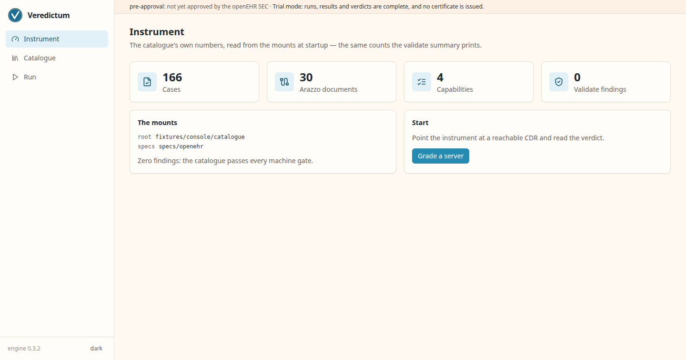
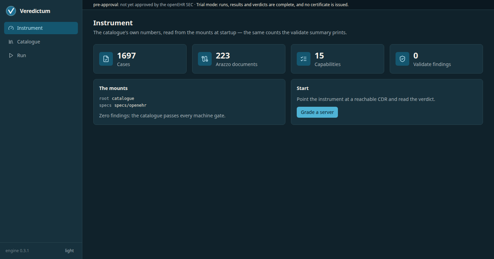

## The catalogue explorer

Capability folders first, each with the number of cases it carries. The search
and page state live in the URL, so a view is shareable and survives a refresh.

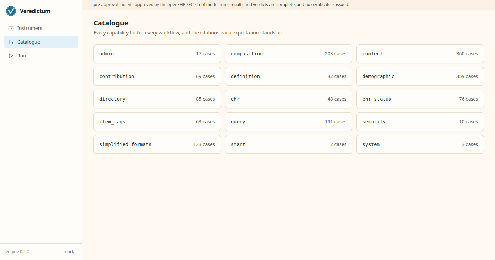
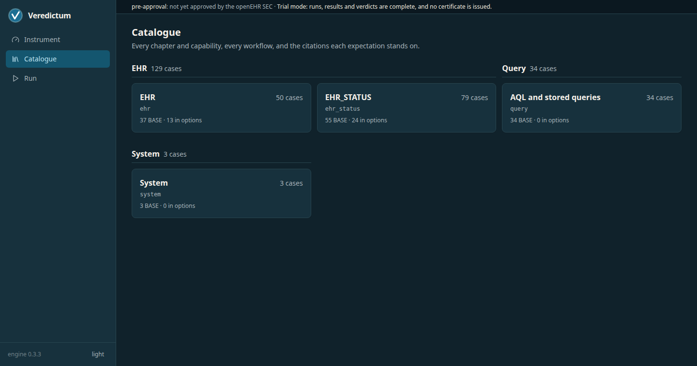

One capability lists its cases, one section per Arazzo document: the case id
and the workflow's summary. One behaviour per case, so a red row names one
defect.

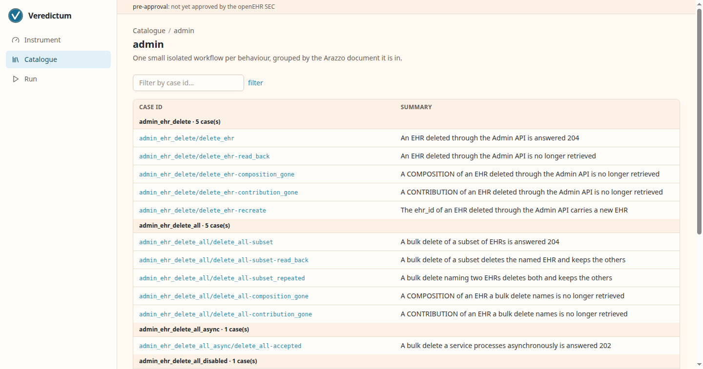
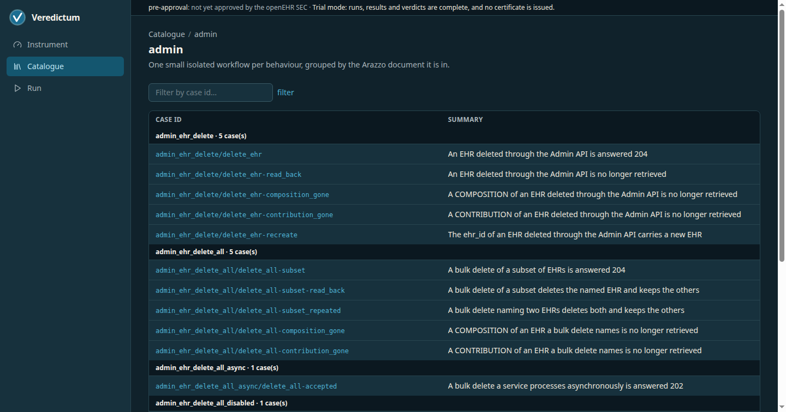

## One case in full

The case detail carries the workflow's description, the specification citation
the workflow stands on, the option arm its document tests when an option names
it, and every step with the operation it calls. The citation is the point: an
expectation is refuted by a better reading of the cited text, and by nothing
else.

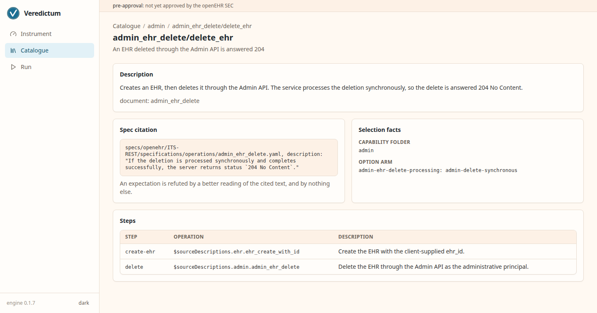
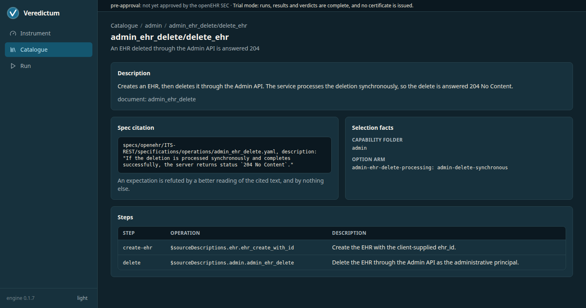

## The run wizard

Grading starts at Connect: the CDR base URL, the display identity, the
authentication choice from the ixit's own vocabulary, and a probe whose
answer renders verbatim before anything continues.

An administrative credential is optional and separate from the server's. The
run receives it through `--admin-auth` and the `VEREDICTUM_CDR_ADMIN_*`
variables ([Logging in to the CDR](authentication.md)); without one, every
workflow with an administrative step is skipped as `not-declared`, and the
IXIT the run writes names no administrative principal.

The display name and version label stay editable after the probe, and Continue
carries what the screen shows to the run. The address and the credentials are
what the probe tested, so editing one of them after the probe withholds
Continue until you probe again, and the screen says so.

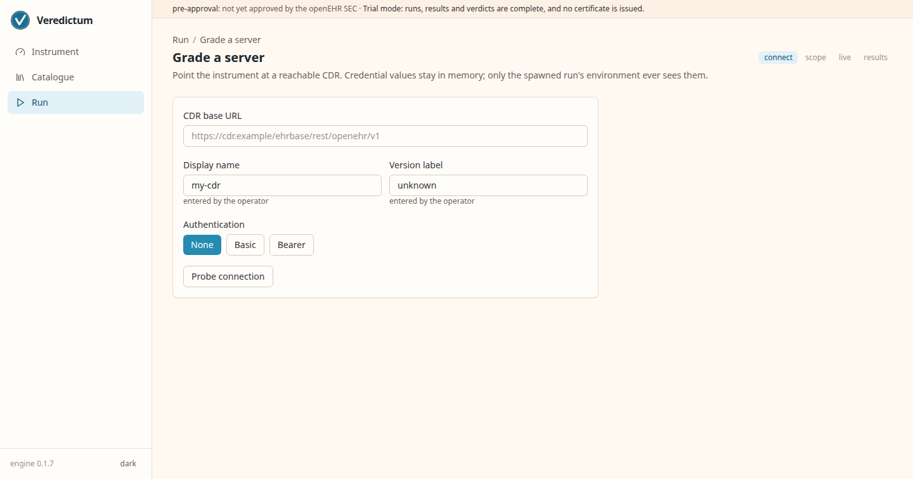
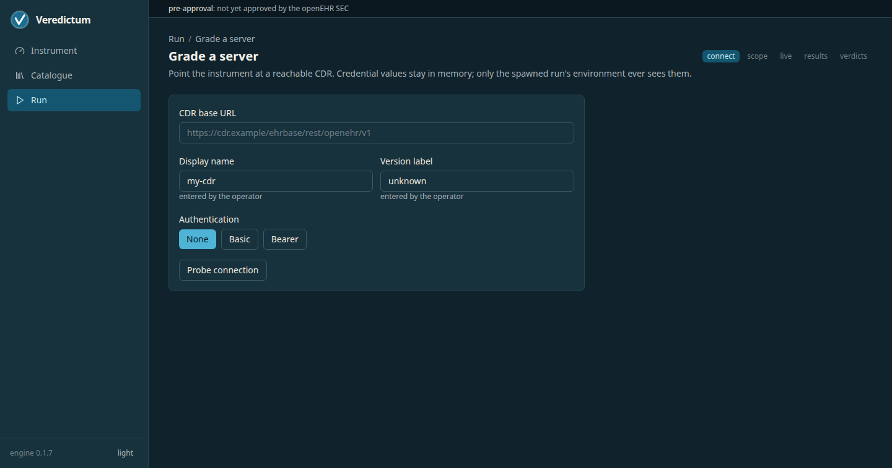

Scope takes the claim the run grades: the vendor's own statement.json (the
ICS, the document that says which capabilities are claimed and which option
arms are selected), pasted into the box. The console offers no declaration of
its own to load, because the claim belongs to whoever makes it: ISO/IEC 9646-7
assigns an ICS proforma's support and supported-values columns to the supplier
of the implementation.

The claim can also be built on the screen. The capability row offers every
capability folder of the catalogue with the documents and cases it holds.
Composing writes the claim into the same box, product identity taken from the
Connect step, so the operator reads the exact document the run selects by.
Options stay undeclared there: only the party running the server knows which
arm it realizes.

The document is held to the published statement schema before anything is
stored, and saving answers with the claim overview (product and capability
count) beside the selection preview, so the screen says what will run before
anything starts. An empty box is an honest no-claim run: every capability runs
and no option arm is selected. The document-id filter narrows the run to the
documents whose id contains it.

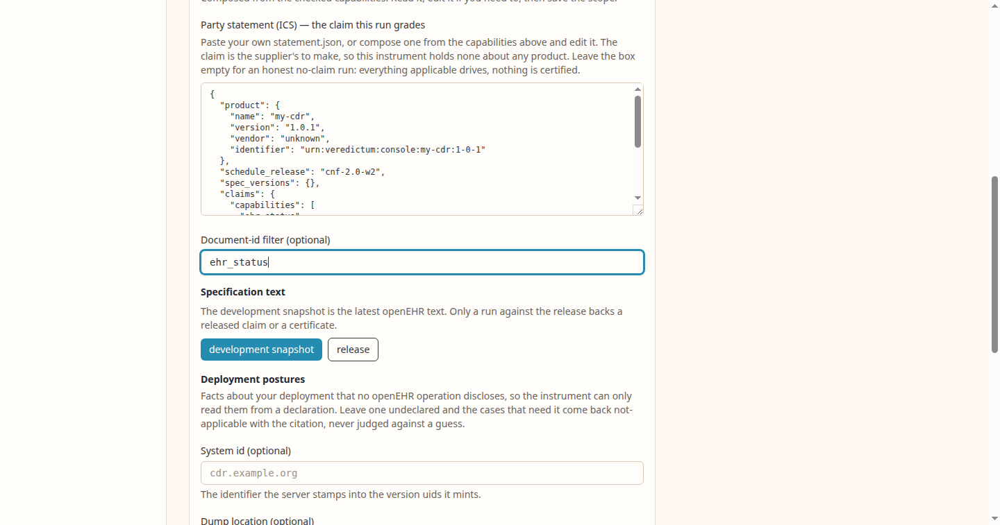

The run is the engine's own `veredictum test`, with the credentials in the
spawned process's environment only. The live screen names the server and
version the run records, and shows the elapsed clock and the tail of the
engine's output, and when the run finishes the outcome
links straight to the results.

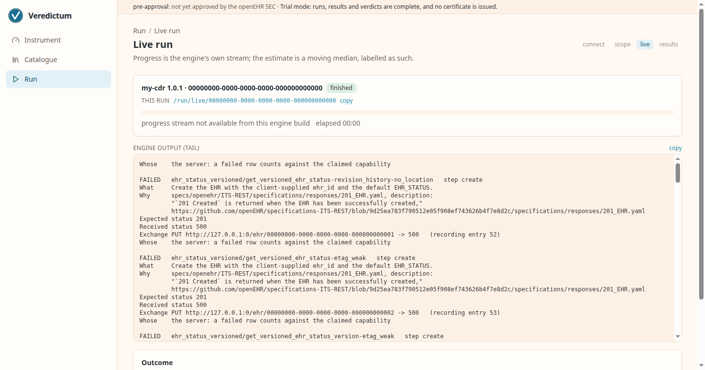

## The results

Results reads the finished run's own `results.json`, red rows first: failed
rows, then errored rows under their own status. An errored row is the
instrument saying it could not judge, and its detail names what stopped the
judgement. A row
links to its detail: the four-part explanation the engine wrote (what was
checked, why it is required with the cited sentence, what was expected and
what was received, and whose problem the row is), which is what
[the attribution](methodology.md#when-a-run-goes-red) of that row turns on.

The detail ends with the wire: the exchange the row was judged on, read from
the run's `recording.har`, as its request and response panes, verbatim. The
recording holds a server's response bodies, so it can carry real patient data
from the deployment being graded, and it lands in the operator's own output
directory.

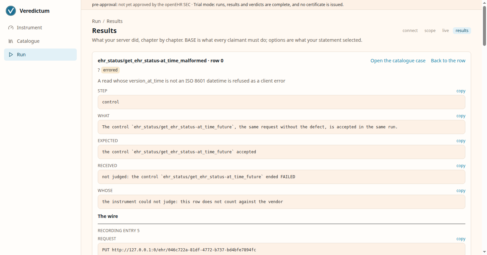

## Certificates, and trial mode

A console issues certificates only when `VEREDICTUM_CERTIFICATES=issue` is
set; unset, `trial` or any other value is trial mode, which is the default.
In trial mode every page's status banner says so, the results page says no
certificate is issued, and the console reads no signing key at all.

With issuance on, the console also reads the Ed25519 key that
`VEREDICTUM_SIGNING_KEY_FILE` names and the key id `VEREDICTUM_SIGNING_KID`
gives it, and refuses to start unless the JWK Set it serves at
`/.well-known/jwks.json` publishes that key, unrevoked and unexpired. Each
finished run then gets `certificate.jws` beside its results, and the results
page offers it as a download. [Verifying a certificate](trust.md#verifying-a-certificate)
is the reader's side.

## Running it in public

The hosted instrument at
[console.veredictum.eu](https://console.veredictum.eu) is this console served
publicly, and a public console has two problems a local one does not.

**It drives whatever endpoint a visitor names.** `VEREDICTUM_POSTURE=hosted`
turns on the target guard: loopback, private, link-local, unique-local,
unspecified, multicast, carrier-shared and broadcast addresses are refused in
both families before any socket opens, and the name is resolved first, because
a name under a visitor's control resolving to a private address is the whole
problem. The variable's default is `local`, which refuses nothing — driving a
CDR at `localhost` is the normal local case. A value that is neither refuses
to start, rather than falling back to the permissive one on a typo.

**It has to tell its visitors apart.** With no login, that is the peer address.
Behind a proxy the peer is the proxy, so `VEREDICTUM_CLIENT_IP_HEADER` names
the header carrying the real client address — and only a header the operator
names is read, because an unconditionally trusted `X-Forwarded-For` would let
any visitor claim any identity and defeat the per-visitor caps. Unset, the
socket peer is the whole answer.

Both are documented with the rest of the hosted posture in the repository's
`deploy/hosted/` directory.

## An address the console does not serve

A path outside the route tree answers `404` and renders it: the same chrome,
the path that missed named back to you, and two ways on. Nothing was run and
nothing was judged, which is what the page says.

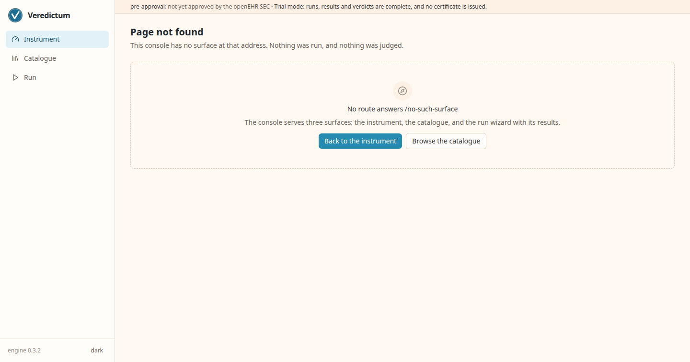
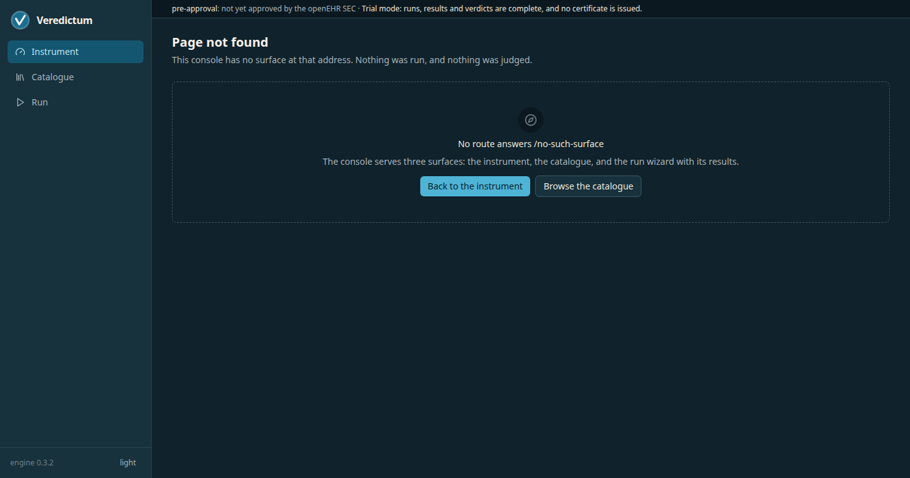

## Two real servers, side by side

The same catalogue, the same wizard and the same judgement, driven against two
live CDRs pulled at their latest published images: FerroEHR's quickstart and
EHRbase's official pairing. The run behind each column is the EHR documents of
the catalogue, and every difference below traces to a case id and its
citation.

| FerroEHR (latest) | EHRbase (latest) |
|---|---|
|  |  |

These captures come from the same E2E harness that gates the console
(`UI_E2E_REAL_SUTS=1 scripts/ui-e2e.sh`): the browser drives the real wizard
against the real servers, and the book shows what it photographed.
